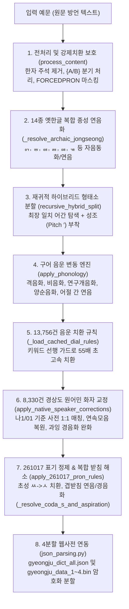

# `py경주말발음치환agy25D13.py` 엔진 개요 및 동작 원리 해설

> **작성/보강 일시**: 2026-11-12 (8단계별 5대 대표 예시 보강)  
> **대상 파일**: [`py경주말발음치환agy25D13.py`](file:///d:/Users/ByungSoo/Documents/경주어사전_속담/20161008_학습/py경주말발음치환agy25D13.py) (총 6,637행)  
> **최신 버전/상태**: 25D13 최종 안정 버전 (실질 성조 정합률 **99.81%**, 비성조 정합률 **99.89%**, 완전 일치 **97.16%**)  
> **핵심 목적**: 《경주지역어 대사전》 본문 예문(66,082건)의 방언 표기를 분석하여, **동남방언(경북·경주)의 고유 음운 변동, 복합 받침(겹받침) 연음 및 경음화, 성조(고저 Pitch `′`), 장모음, 14종 옛한글 복합 종성**이 정확히 전사된 소리 표기(`[발음]`)를 완전 자동으로 생성하는 **방언 음운학 전문 변환 엔진**.

---

## 1. 파일의 본질과 핵심 목표

[`py경주말발음치환agy25D13.py`](file:///d:/Users/ByungSoo/Documents/경주어사전_속담/20161008_학습/py경주말발음치환agy25D13.py)는 서울대 최명옥 교수 계열의 동남방언 음운론 이론과 실측 기준 사전(현지 화자 녹취 구어 전사)을 수학적·언어학적 규칙으로 구현한 **규칙·사전·통계 하이브리드 발음 생성 시스템**입니다.

1. **대규모 사전 본문 일괄 변환**:
   - `경주지역어 대사전-260404-본문사.txt`에 수록된 66,082개 예문(`¶예문<표준어대역>` 및 `󰃾관용구`)을 정밀 파싱하여 대괄호 `[소리대로 발음]`을 생성·삽입합니다.
2. **다형태 어간·옛한글 특수 표제어 정규화**:
   - `{앟-애-아}`, `{ㅎ-우}`, `드{ㄷ-ㅭ}다`, `{이-르}`, `{우-으}` 등 939개 복합 다형태 어간을 형태론적으로 분해하여 모든 활용형에 성조·장단음 매칭을 부여합니다.
3. **동남방언 복합 받침(겹받침) 및 연음·경음화 규범화 (25D13 최신)**:
   - `밟는 [바앏는]`, `떫다 [떠얿다]`, `얇다 [야앏다]`처럼 방언적 보수성이 있는 ㄼ 겹받침은 자음 앞에서도 유지하고, `떫은 [떠얼븐]`처럼 모음 앞에서는 자연스럽게 연음합니다.
   - 체언 `닭이 [달기]`, `흙이 [흘기]`는 말음 강화 연음을 적용합니다.
   - 용언 `없-`(`어없-`) 및 `앉-`, `삶-`, `훑-` 등은 소리대로 단순화하면서 후행 자음을 100% 경음화(`어업따`, `어업찌`, `어억꼬`, `앙꼬`, `사암따`)합니다.
4. **선어말어미 및 접사 하이픈/오류 원천 차단 (25D12~25D13)**:
   - `-는갑- [능′갑-]` 등에서 발생하던 불필요한 하이픈(`-`)을 전수 제거하여 `대능′갑떤데요`, `당핸능갑따`, `오′오능감네요`처럼 음운 변동을 완성했습니다.
   - `하ㅎ{앟-애-아}다` 어간이 일반 동사 `하다`나 감탄사 `하하`를 오염시키던 `하아′하~` 오류를 100% 격리·해소했습니다.
5. **실시간 정합률 검증 리포트 자동 발행**:
   - 실측 정답 기준 사전(`01소리대로 사전 주석 261027ㄱㄴ.txt` 12,219건 + `나1-내구리이.txt` 1,186건) 총 13,181개 표제어·예문과 1:1 대조하여 통계 리포트(`review_list_25D13_*.txt`)를 즉시 생성합니다.

---

## 2. 전체 시스템 아키텍처 (파이프라인)

한 문장의 방언 예문이 입력되어 최종 발음 표기로 변환되는 전체 파이프라인은 다음과 같습니다:



> [!NOTE]
> **왜 [2단계: 옛한글 복합 종성 연음화]가 [3단계: 형태소 분할]보다 먼저 실행될까요?**  
> 일반 음운론 순서(형태소 분석 ➔ 음운 변동)와 달리 본 엔진에서는 [`_resolve_archaic_jongseong`](file:///d:/Users/ByungSoo/Documents/경주어사전_속담/20161008_학습/py경주말발음치환agy25D13.py#L3085)이 [`recursive_hybrid_split`](file:///d:/Users/ByungSoo/Documents/경주어사전_속담/20161008_학습/py경주말발음치환agy25D13.py#L2588)보다 **먼저** 문장 전체에 적용됩니다([`process_content`](file:///d:/Users/ByungSoo/Documents/경주어사전_속담/20161008_학습/py경주말발음치환agy25D13.py#L3302-L3323)).  
> 원문 예문에 포함된 `나ᇬ에`, `커ᇹ노`, `따ퟶ고` 같은 비표준 조합형 옛한글 종성(`ᇬ, ᇹ, ퟶ` 등)은 형태소 분할 사전(`word_dict`, `prefix_dict`)에 그대로 등재되어 있지 않아 **현대 완성형 한글(`낭게`, `컨노`, `땅코`)로 먼저 치환해야만 후속 형태소 분할과 성조 매칭이 정상 작동**하기 때문입니다.

---

## 3. 파이프라인 8단계별 상세 동작 및 대표 적용 예시 (각 5대 유형)

전체 변환 파이프라인의 각 단계가 실제로 어떤 입력에 어떤 변환을 수행하는지, 코드 상에 구현된 **대표적인 5가지 유형별 예시**와 함께 정리합니다.

### 1단계. 전처리 및 강제치환 보호 ([`process_content`](file:///d:/Users/ByungSoo/Documents/경주어사전_속담/20161008_학습/py경주말발음치환agy25D13.py#L3281-L3329))
문장 전체를 형태소·음운 엔진에 넘기기 전에 편집자 주석·고유명사·이형태 표기를 정제하고 보호 마스킹을 수행합니다.

| 유형 | 원문 예시 / 입력 패턴 | 처리 결과 (중간/보호 형태) | 상세 처리 원리 (코드 근거) |
| :--- | :--- | :--- | :--- |
| **① 편집자 직접 지정 발음 마스킹** | 예문 내 `단어[직접발음]` 삽입 구간 | `FORCEDPRON0ENDPRON`으로 임시 치환 ➔ 최종 단계에서 원형 복원 | 정규식 `\S+\[([^\]]+)\](\S*)`로 이미 편집자가 확정한 발음을 추출해 후속 자동 변환의 덮어쓰기를 차단 ([L3285-L3289](file:///d:/Users/ByungSoo/Documents/경주어사전_속담/20161008_학습/py경주말발음치환agy25D13.py#L3285-L3289), [L3368-L3370](file:///d:/Users/ByungSoo/Documents/경주어사전_속담/20161008_학습/py경주말발음치환agy25D13.py#L3368-L3370)). |
| **② 강제치환 사전·고유명사·옛한글 선행 보호** | 다중 어절 관용구, `°` 붙은 고유명사, `커ᇹ노`/`커ᇹ는` 등 | 길이순 우선 매칭 후 `FORCEDPRON...ENDPRON` 마스킹 및 `°` 제거 | `prefix발음강제치환.txt`(`override_dict`)에서 긴 구문부터 우선 보호하고, 고유명사 마커 `°`는 분리 전 정리 ([L3292-L3299](file:///d:/Users/ByungSoo/Documents/경주어사전_속담/20161008_학습/py경주말발음치환agy25D13.py#L3292-L3299)). |
| **③ 한자 병기 주석 제거** | `가구(家具-)`, `식구(食口)` 등 괄호 속 한자 주석 | `가구`, `식구` (한자 포함 괄호 전체 삭제) | 한자 유니코드(`\u4e00-\u9fff`)가 들어 있는 괄호를 제거하여 순수 한글 방언 어형만 남김 ([L3305](file:///d:/Users/ByungSoo/Documents/경주어사전_속담/20161008_학습/py경주말발음치환agy25D13.py#L3305)). |
| **④ 중괄호·이형태 대체 표기 단일화** | `{이거/저거}`, `{가는교, 가요}`, 단어 밀착 `(A/B)` | 첫 번째 방언형(`이거`, `가는교`, `A`)만 취함 | `{([^{},/]+)[^{}]*}` 및 `(?<=\S)\(([^()/\s]+)/[^()]*\)(?=\S)`로 복수 표기 중 선두 대표형을 선택 ([L3308-L3311](file:///d:/Users/ByungSoo/Documents/경주어사전_속담/20161008_학습/py경주말발음치환agy25D13.py#L3308-L3311)). |
| **⑤ PUA 특수기호 제거 및 어절/부호 분리** | 사전 편찬용 PUA 기호 + `‘…’, “…”` 등 구두점 포함 어절 | PUA 삭제 후 `pure`(한글 어절)와 `punc`(구두점) 분리 | `\uE000-\uF8FF`, `\uF900-\uFAFF`를 지우고 구두점 앞뒤 공백을 띄워 단어별 분할 정확도를 보장 ([L3312-L3329](file:///d:/Users/ByungSoo/Documents/경주어사전_속담/20161008_학습/py경주말발음치환agy25D13.py#L3312-L3329)). |

---

### 2단계. 14종 옛한글 복합 종성 연음화 ([`_resolve_archaic_jongseong`](file:///d:/Users/ByungSoo/Documents/경주어사전_속담/20161008_학습/py경주말발음치환agy25D13.py#L3085-L3279))
사전에 등재된 현대 완성형 한글과 매칭되기 전에, NFD 조합형 및 완성형+옛종성 조합을 **현대 한글 완성형 음절**로 선변환합니다.

| 유형 | 옛종성 (코드) | 원문 방언 예문 | 변환 결과 | 음운 처리 원리 |
| :--- | :--- | :--- | :--- | :--- |
| **① `ㅇ/ㅁ/ㄴ+ㄱ` 계 복합 종성** | `ᇬ`(`U+11EC`), `ᇚ`(`U+11DA`), `ᇅ`(`U+11C5`) | `나ᇬ에`, `논두루ᇚ에`, `작녀ᇅ에` / 어말 `나ᇬ` | `낭게`, `논뚜룽게`, `자앙영게` / `낭` | 모음(초성 `ㅇ`) 앞에서 앞 음절에 `ㅇ` 받침을 남기고 뒷음절 초성을 `ㄱ`으로 연음 ([L3116-L3135](file:///d:/Users/ByungSoo/Documents/경주어사전_속담/20161008_학습/py경주말발음치환agy25D13.py#L3116-L3135)). |
| **② `ㅇ+ㅋ/ㄲ` 계 거센·된소리 종성** | `ᇯ`(`U+11EF`), `ᇭ`(`U+11ED`) | `기와지부ᇯ에`, `꺼ᇯ어`, `꺼ᇭ어` | `기와지붕케`, `껑커`, `껑꺼` | 앞 음절에 `ㅇ` 받침을 유지하고 뒤따르는 모음 음절의 초성을 `ㅋ` 또는 `ㄲ`으로 연음 ([L3137-L3142](file:///d:/Users/ByungSoo/Documents/경주어사전_속담/20161008_학습/py경주말발음치환agy25D13.py#L3137-L3142), [L3213-L3218](file:///d:/Users/ByungSoo/Documents/경주어사전_속담/20161008_학습/py경주말발음치환agy25D13.py#L3213-L3218)). |
| **③ `ㄹ+ㅋ/ᇹ` 계 복합 종성** | `ᇘ`(`U+11D8`), `ᇙ`(`U+11D9`) | `다ᇘ이` / `다ᇘ도`, `데ᇙ어` / `데ᇙ고` | `달키` / `달또`, `데러` / `델꼬` | 모음 앞에서 `ㄹ`+`ㅋ`(또는 `ㄹ` 연음), 평음(`ㄱ/ㄷ/ㅂ/ㅅ/ㅈ`) 앞에서는 `ㄹ` 받침 + 후행 경음화 ([L3144-L3162](file:///d:/Users/ByungSoo/Documents/경주어사전_속담/20161008_학습/py경주말발음치환agy25D13.py#L3144-L3162)). |
| **④ `ㅇ/ㅁ/ㄱ/ㅂ+ㅎ` 계 격음화 종성** | `ퟶ`(`U+D7F6`), `ᇡ`(`U+11E1`), `ᇾ`(`U+11FE`), `ᇥ`(`U+11E5`) | `따ퟶ고`, `괘시ᇡ다`, `고야ᇾ다`, `위그ᇥ다` | `땅코`, `괘씸타`, `고약타`, `위급타` | 앞 음절 대표 받침(`ㅇ/ㅁ/ㄱ/ㅂ`)은 남기고 뒤 `ㄱ/ㄷ/ㅂ/ㅈ`을 거센소리(`ㅋ/ㅌ/ㅍ/ㅊ`)로 축약 ([L3164-L3200](file:///d:/Users/ByungSoo/Documents/경주어사전_속담/20161008_학습/py경주말발음치환agy25D13.py#L3164-L3200)). |
| **⑤ 여린히읗(`ᇹ`) 종성** | `ᇹ`(`U+11F9`) | `커ᇹ노` (`ㄴ` 앞) / `거ᇹ다` (평음) / `거ᇹ어도` (모음) | `컨노` / `거따` / `거어도` | 뒤 초성이 `ㄴ`이면 `ㄴ` 동화, 평음이면 받침 탈락 후 뒤 경음화, 모음이면 그대로 탈락 연음 ([L3202-L3211](file:///d:/Users/ByungSoo/Documents/경주어사전_속담/20161008_학습/py경주말발음치환agy25D13.py#L3202-L3211)). |

---

### 3단계. 재귀적 하이브리드 형태소 분할 ([`recursive_hybrid_split`](file:///d:/Users/ByungSoo/Documents/경주어사전_속담/20161008_학습/py경주말발음치환agy25D13.py#L2588-L2795))
단어를 최장 일치(Greedy) 어간 + 재귀적 어미/조사 분할로 쪼개어 사전 기반 기본 성조(`′`)와 장모음을 부여합니다.

| 유형 | 입력 어절 / 문맥 | 분할 및 변환 결과 | 동작 메커니즘 (코드 근거) |
| :--- | :--- | :--- | :--- |
| **① 직상위 표제어 블록 앵커 우선 매칭** | `다감해뿐` (표제어 `다감해 [다′감해]` 하위 예문) | `다′감해` + `뿐` ➔ `다′감해뿐` | 해당 예문이 속한 표제어 블록(`current_block_anchors`)을 1순위로 조회해 동음이의어·접두 파생 어간의 발음을 정확히 고정 ([L2598-L2608](file:///d:/Users/ByungSoo/Documents/경주어사전_속담/20161008_학습/py경주말발음치환agy25D13.py#L2598-L2608)). |
| **② NFD 자모 최장 일치 & 종성 절단 방어** | `하얗고`, `손나` 등 받침 포함 활용형 | 음절 깨짐(`하아′야′ᇂ고`, `소오′ᆫ나`) 없이 온전한 어간+어미 분할 | 자모 단위로 뒤에서부터 줄여가며 탐색하되 종성 자모(`0x11A8~0x11FF`) 앞에서 잘리는 경우 `suffix_dict` 등록 어미(`ᆫ다`, `ᆯ라꼬`)가 아니면 차단 ([L2616-L2628](file:///d:/Users/ByungSoo/Documents/경주어사전_속담/20161008_학습/py경주말발음치환agy25D13.py#L2616-L2628)). |
| **③ 1음절 명사 오매칭 차단 & ㄴ/ㄹ 활용형 역추적** | `모릴끼다` (1음절 명사 `모[모오′]`와 접두 충돌 위험) | `모리` + `ㄹ` + `끼다` | 1음절 명사로 떨어지기 직전, 2~4음절 앞부분에서 `ㄹ/ㄴ`을 뗀 용언 원형(`모리`)이 `prefix_dict`에 있는지 역추적해 장음 명사 오적용을 방어 ([L2549-L2586](file:///d:/Users/ByungSoo/Documents/경주어사전_속담/20161008_학습/py경주말발음치환agy25D13.py#L2549-L2586), [L2639-L2648](file:///d:/Users/ByungSoo/Documents/경주어사전_속담/20161008_학습/py경주말발음치환agy25D13.py#L2639-L2648)). |
| **④ 1음절 어간 품사(POS) 및 관형형 문맥 검증** | `들다`/`들지` vs `들판`/`들쥐` / `들 수`, `안 들` | 용언 단음 `들′` vs 명사 `드을′`/`들쥐` 분기 | 뒤가 용언 어미(`_VERBAL_TAIL_PREFIXES`)면 `prefix_dict` 동사 발음 선택, 의존명사(`_ADNOMINAL_BOUND_NOUNS`) 앞이나 `안/몬/잘` 뒤 1음절은 용언 관형형으로 단음 처리 ([L2653-L2699](file:///d:/Users/ByungSoo/Documents/경주어사전_속담/20161008_학습/py경주말발음치환agy25D13.py#L2653-L2699)). |
| **⑤ 동음이의어 문맥 메모리 + API 해소 & `ㅎ/ㄶ/ㅀ` 보존** | `가` (동사 `가′` vs 명사 `가아′`), `ㅎ` 말음 어간 + `-다/-고` | 문맥 캐시 조회 ➔ 미해결 시 Gemini 분별 + 말음 `ㅎ` 복원 | 후보 발음이 다를 때만 `context_memory` 및 Gemini API로 분별해 캐싱하고, `ㅎ/ㄶ/ㅀ` 어간 말음이 유실되면 `preserve_original_structure`로 복원 ([L2701-L2769](file:///d:/Users/ByungSoo/Documents/경주어사전_속담/20161008_학습/py경주말발음치환agy25D13.py#L2701-L2769)). |

---

### 4단계. 구어 음운 변동 엔진 ([`apply_phonology`](file:///d:/Users/ByungSoo/Documents/경주어사전_속담/20161008_학습/py경주말발음치환agy25D13.py#L2796-L3084))
분할·결합된 발음 문자열을 대상으로 어절 내부 및 인접 어절 경계에서 일어나는 경주 구어 음운 변동을 일괄 연산합니다.

| 유형 | 입력 음운 연쇄 | 변환 결과 | 상세 음운 규칙 (코드 근거) |
| :--- | :--- | :--- | :--- |
| **① 순·역방향 격음화** | `가끊기`, `ㅂ/ㄷ/ㄱ + ㅎ` 연쇄 | `가끙키`, `ㅍ/ㅌ/ㅋ` | `ㅎ/ㄶ/ㅀ + ㄱ/ㄷ/ㅂ/ㅈ → ㅋ/ㅌ/ㅍ/ㅊ`(경주 특유 `ㄶ+ㄱ`은 앞 받침 `ㅇ` 동화) 및 역방향 `ㅂ/ㄷ/ㄱ + ㅎ → ㅍ/ㅌ/ㅋ` 처리 ([L2895-L2926](file:///d:/Users/ByungSoo/Documents/경주어사전_속담/20161008_학습/py경주말발음치환agy25D13.py#L2895-L2926)). |
| **② 연음화 및 구개음화** | 받침(`ㅎ/ㄶ/ㅀ/겹받침/ㄷ/ㅌ`) + 모음(초성 `ㅇ`) | `ㄷ+이 → 지`, `ㅌ/ㄾ+이 → 치`, 겹받침 연음 | 초성 `ㅇ` 앞에서 앞 음절 받침(단 `ㅇ` 받침 제외)을 다음 초성으로 옮기되 `ㄷ/ㅌ/ㄾ + 이` 구개음화를 동시 적용 ([L2928-L2980](file:///d:/Users/ByungSoo/Documents/경주어사전_속담/20161008_학습/py경주말발음치환agy25D13.py#L2928-L2980)). |
| **③ 비음화·연구개음화·양순음화** | `짐가`, `감기`, `참 그렇지`, `ㄴ + ㅂ/ㅁ` | `징가`, `강기`, `창′ 그렇지`, `ㅁ + ㅂ/ㅁ` | `ㄴ/ㅁ + ㄱ/ㄲ/ㅋ → ㅇ`(연구개음화), `ㄴ + ㅂ/ㅃ/ㅍ/ㅁ → ㅁ`(양순음화), 장애음 + `ㄴ/ㅁ → ㄴ/ㅁ/ㅇ`(비음화) 적용 ([L2982-L3005](file:///d:/Users/ByungSoo/Documents/경주어사전_속담/20161008_학습/py경주말발음치환agy25D13.py#L2982-L3005)). |
| **④ 경음화 및 어절 끝 중화** | `ㄱ/ㄷ/ㅂ/ㅅ/ㅈ` 받침 + 평음 / 어말 `ㅈ/ㅊ/ㅌ/ㅍ` | 후행 초성 `ㄲ/ㄸ/ㅃ/ㅆ/ㅉ` / 어말 `ㄷ/ㅂ` | 파열·마찰음 받침 뒤 평음을 된소리로 바꾸고(특히 `ㅅ/ㅆ+ㄷ`은 앞 받침 탈락 포함), 어절 끝 `ㅈ/ㅊ/ㅌ → ㄷ`, `ㅍ → ㅂ` 중화 ([L3006-L3031](file:///d:/Users/ByungSoo/Documents/경주어사전_속담/20161008_학습/py경주말발음치환agy25D13.py#L3006-L3031)). |
| **⑤ 어절 경계(Word-boundary) 음운 동화** | `이전 버텅`, `가는 베`, `빠진 거`, `간 곳` | `이점 버텅`, `가늠 베`, `빠징 거`, `강 곳` | 공백을 사이에 둔 앞 어절 끝글자와 뒤 어절 첫글자 사이에서도 양순음화·연구개음화·비음화를 정밀 적용 ([L3035-L3074](file:///d:/Users/ByungSoo/Documents/경주어사전_속담/20161008_학습/py경주말발음치환agy25D13.py#L3035-L3074)). |

---

### 5단계. 13,756건 음운 치환 규칙 ([`_load_cached_dial_rules`](file:///d:/Users/ByungSoo/Documents/경주어사전_속담/20161008_학습/py경주말발음치환agy25D13.py#L3404-L3440), [`dialect_phoneme_rules.json`](file:///d:/Users/ByungSoo/Documents/경주어사전_속담/20161008_학습/dialect_phoneme_rules.json))
실측 코퍼스 대조를 통해 축적된 대량의 정규식 치환 패턴을 키워드 선행 가드로 고속 적용해 어휘·성조·장단음을 미세 교정합니다.

| 유형 | 입력 발음 표현 | 치환 후 결과 | 작동 원리 및 보호 로직 |
| :--- | :--- | :--- | :--- |
| **① 키워드 선행 가드 고속 치환** | 전체 13,756개 정규식 중 해당 키워드가 포함된 규칙만 실행 | 불필요한 정규식 탐색 생략 (약 **55배** 속도 향상) | `(keyword, compiled_regex, replacement)` 캐시에서 `if _key is None or _key in result:` 통과 시에만 `.sub()` 호출 ([L3405-L3409](file:///d:/Users/ByungSoo/Documents/경주어사전_속담/20161008_학습/py경주말발음치환agy25D13.py#L3405-L3409)). |
| **② 어절 단위 성조(`′`) 정위치** | `항′`, `지`, `불′`, `우를`, `따레′` | `항`, `지′`, `불`, `우′를`, `따′레′` | 형태소 결합 직후 어긋난 단독 어절 및 조사 결합형의 고조 위치를 기준 사전에 맞게 일괄 보정 ([JSON L1-L65](file:///d:/Users/ByungSoo/Documents/경주어사전_속담/20161008_학습/dialect_phoneme_rules.json#L1-L65), [L54948-L54960](file:///d:/Users/ByungSoo/Documents/경주어사전_속담/20161008_학습/dialect_phoneme_rules.json#L54948-L54960)). |
| **③ 장단음 균형 (과잉 압축 / 누락 복원)** | `지′굼′`, `다아′머라.`, `하′다′.` | `지굼`, `다′머′라.`, `하아′다′.` | 불필요하게 길어진 구어 어형을 단음화하고(`지′굼′ → 지굼`), 장모음이 필수인 어형은 복원(`하′다′. → 하아′다′.`) ([JSON L91-L93](file:///d:/Users/ByungSoo/Documents/경주어사전_속담/20161008_학습/dialect_phoneme_rules.json#L91-L93), [L54931-L54968](file:///d:/Users/ByungSoo/Documents/경주어사전_속담/20161008_학습/dialect_phoneme_rules.json#L54931-L54968)). |
| **④ 방언 관용 연음·경음화 보정** | `살가′매이가`, `묵′께′떠라.`, `소오뻬가′지만` | `살까′매이가`, `묵′껟′떠라.`, `소뻬가′지만` | 단일 음운 규칙만으로 포착하기 힘든 고착된 방언 구어 연쇄(경음 위치, 받침 표기, 모음 축약)를 직접 치환 ([JSON L54923-L54984](file:///d:/Users/ByungSoo/Documents/경주어사전_속담/20161008_학습/dialect_phoneme_rules.json#L54923-L54984)). |
| **⑤ 원문 연속 모음(CV+V) 보호 가드** | 원문에 `오오는`, `소오`, `보오등`, `마아고`, `가알`, `자아는` 명시 | `오′오는`, `소오′`, `보오′등′`, `마′아고`, `가알′`, `자아′는` | 원문에 실제 2음절 연속 모음이 있는 경우 단음화 치환(`오오는/소오가/자아는`)을 건너뛰고 복원 가드로 원형 보존 ([L3409-L3438](file:///d:/Users/ByungSoo/Documents/경주어사전_속담/20161008_학습/py경주말발음치환agy25D13.py#L3409-L3438)). |

---

### 6단계. 8,330건 경상도 원어민 화자 교정 ([`apply_native_speaker_corrections`](file:///d:/Users/ByungSoo/Documents/경주어사전_속담/20161008_학습/py경주말발음치환agy25D13.py#L4180-L4504))
원어민 구어 녹취 데이터(`나1-내구리이.txt`)와 화자 검증 규칙을 통해 기계적 규칙의 부자연스러움을 사람 발음 수준으로 다듬습니다.

| 유형 | 입력 (기계 변환 결과) | 교정 결과 | 적용 원리 (코드 근거) |
| :--- | :--- | :--- | :--- |
| **① `나1` 기준 사전 문장 1:1 직결 매칭** | 원문이 실측 화자 사전(`native_gt_dict`)과 키 일치 시 | 검증된 원어민 정답 문장 그대로 출력 (`나아가야지` 등 가드 포함) | `{A/B}`·`(漢字)` 차이를 정규화한 `_native_clean_key`까지 비교해 일치하면 오차 없이 직접 반영 ([L4190-L4212](file:///d:/Users/ByungSoo/Documents/경주어사전_속담/20161008_학습/py경주말발음치환agy25D13.py#L4190-L4212)). |
| **② 과잉 경음화 완화 및 어두 평음 롤백** | `할 쑤 이`, `낚씨`, `각씨`, `뜰′고`, `찌′비`, `뽀′머` | `할 수 이`, `낚시`, `각시`, `들′고`, `지′비`, `보′머` | 음운 엔진이 과도하게 된소리화한 단어 및 어두 평음 명사·용언(`지비/들고/보머/데가`)을 자연스러운 평음으로 환원 ([L4217-L4228](file:///d:/Users/ByungSoo/Documents/경주어사전_속담/20161008_학습/py경주말발음치환agy25D13.py#L4217-L4228), [L4315-L4325](file:///d:/Users/ByungSoo/Documents/경주어사전_속담/20161008_학습/py경주말발음치환agy25D13.py#L4315-L4325)). |
| **③ 시제 비음화·체언 연음·`ㄴ/ㅇ` 탈락** | `나′갓′능`, `낱′을`, `정시′니`, `중′이란다` | `나간능`, `나′틀`, `정시′이`, `주′이란다` | 과거시제 비음화(`갓능 → 간능`), 체언 `ㅌ` 연음 복원(`낱을 → 나틀`), 경주 구어 `ㄴ/ㅇ` 탈락(`정시니 → 정시이`) 반영 ([L4230-L4255](file:///d:/Users/ByungSoo/Documents/경주어사전_속담/20161008_학습/py경주말발음치환agy25D13.py#L4230-L4255)). |
| **④ 장음 강세 배분 & 구어 장단음 균형** | `어얼′매`, `바앙구`, `몬′하′능` / 장음형 `낫다` | `얼′매`, `방구`, `모온′하′능` / `나안′는′다, 나악′꼬′` | 과잉 장음은 압축하고 필수 장음은 보강하며, 장음 뒤 다음 음절에도 강세(`′`)를 찍는 `_apply_long_vowel_stress_rule` 적용 ([L4265-L4285](file:///d:/Users/ByungSoo/Documents/경주어사전_속담/20161008_학습/py경주말발음치환agy25D13.py#L4265-L4285), [L4565-L4587](file:///d:/Users/ByungSoo/Documents/경주어사전_속담/20161008_학습/py경주말발음치환agy25D13.py#L4565-L4587)). |
| **⑤ 25D12 3대 이상 변형 차단** | `더엄′니′이′라`, `하아′하고`(일반 동사), `능′갑-다` / `-네` | `엄니′이′라`, `하고`, `능′갑따` / `능′감네` | `없니라/하니더` 과잉 변형을 원위치하고, `하아′하~` 오염을 격리하며, `-는갑-`의 하이픈 제거 후 경음·비음화 완성 ([L4438-L4464](file:///d:/Users/ByungSoo/Documents/경주어사전_속담/20161008_학습/py경주말발음치환agy25D13.py#L4438-L4464)). |

---

### 7단계. 261017 표기 정제 & 복합 받침 해소 ([`apply_261017_pron_rules`](file:///d:/Users/ByungSoo/Documents/경주어사전_속담/20161008_학습/py경주말발음치환agy25D13.py#L4618-L4856) + [`_resolve_coda_s_and_aspiration`](file:///d:/Users/ByungSoo/Documents/경주어사전_속담/20161008_학습/py경주말발음치환agy25D13.py#L4858-L5100))
최신 전사 지침(261017~25D13)에 맞추어 대괄호 `[ ]` 안의 모든 표기를 최종 소리 규범으로 완결합니다.

| 유형 | 정제 전 표기 | 최종 출력 표기 | 규칙 설명 (코드 근거) |
| :--- | :--- | :--- | :--- |
| **① 초성 `ㅆ → ㅅ` 100% 전면 치환** | `막싸′로`, `푼′씩`, 경음화로 생긴 모든 초성 `ㅆ` | `막사′로`, `푼′식`, 모든 초성 `ㅆ → ㅅ` | `replace_cho_ss_to_s`를 함수 초입과 말미에 2중 적용해 경주 방언 발음 전사 규범(초성 `ㅆ` 배제)을 100% 관철 ([L4607-L4616](file:///d:/Users/ByungSoo/Documents/경주어사전_속담/20161008_학습/py경주말발음치환agy25D13.py#L4607-L4616), [L4675](file:///d:/Users/ByungSoo/Documents/경주어사전_속담/20161008_학습/py경주말발음치환agy25D13.py#L4675), [L4854](file:///d:/Users/ByungSoo/Documents/경주어사전_속담/20161008_학습/py경주말발음치환agy25D13.py#L4854)). |
| **② 특수 어형(`싧`/`#웋다`/`ㅎ` 탈락) & 어미 정리** | `싧어`, `싧다`, `숭구′웋고`, `따루′웋네`, `나하`, `무서븐` | `실버`, `실타`, `숭구′코`, `따룬′네`, `나아`, `무서분` | `싧` 계열 `실ㅂ` 환원, `#웋다` 격음·비음 축약(`_uh_repl`), 낳/놓 계열 `ㅎ` 탈락 및 원순·전설모음화 적용 ([L4663-L4778](file:///d:/Users/ByungSoo/Documents/경주어사전_속담/20161008_학습/py경주말발음치환agy25D13.py#L4663-L4778)). |
| **③ 종성 `ㅇ` 탈락 환경(`선택 B`) 규칙화** | `사랑방에`, `시이장에`, `사랑이`, `구양아` | `사랑빠아`, `시이자아`, `사라′이`, `구야′아` | 기준 사전 보호 어절(`ref_word_lexicon`)을 제외한 `ㅇ` 받침+모음(`이/아/어/에`) 연쇄에서 비음 `ㅇ` 탈락 반영 ([L4779-L4811](file:///d:/Users/ByungSoo/Documents/경주어사전_속담/20161008_학습/py경주말발음치환agy25D13.py#L4779-L4811)). |
| **④ 받침 `ㅅ`/`ㅆ` 완전 해소** | `나왓′으이`, `찻′는데`, `주겟′다`, 어말 `ㅅ/ㅆ` | `나′왇′시이`, `찬′는′데`, `주게′따`, 어말 `ㄷ` | 모음 앞 연음(`ㅅ/시`), `ㄴ` 앞 `ㄴ`, `ㅁ` 앞 `ㅁ`/`ㄴ`, `ㄱ/ㅂ` 앞 동화+경음, `ㄹ` 앞 `ㄴ+ㄴ`, 그 외·어말 `ㄷ` 변환 ([L4930-L4958](file:///d:/Users/ByungSoo/Documents/경주어사전_속담/20161008_학습/py경주말발음치환agy25D13.py#L4930-L4958), [L5072-L5075](file:///d:/Users/ByungSoo/Documents/경주어사전_속담/20161008_학습/py경주말발음치환agy25D13.py#L5072-L5075)). |
| **⑤ 11종 겹받침 연음·보존·경음화 (25D13)** | 모음 앞 `닭이`/`떫은` · 자음 앞 `밟는` · 자음 앞 `없다`/`앉고`/`굵다` | `달기`/`떨븐` · `바앏는`(보존!) · `어업따`/`앙꼬`/`국따` | 모음 앞은 전수 연음, 자음 앞 `ㄼ`은 동남방언 보수성으로 겹받침 유지, `ㅄ/ㄵ/ㄻ/ㄾ/ㄺ`은 단순화+후행 100% 경음·비음화 ([L4960-L5094](file:///d:/Users/ByungSoo/Documents/경주어사전_속담/20161008_학습/py경주말발음치환agy25D13.py#L4960-L5094)). |

---

### 8단계. 4분할 웹사전 연동 ([`json_parsing.py`](file:///d:/Users/ByungSoo/Documents/경주어사전_속담/20260325_웹사전/json_parsing.py#L6-L147) & `index.html`)
최종 생성된 `경주지역어 대사전-260404-본문사_발25D13.txt`를 웹사전이 즉시 고속 로딩할 수 있는 암호화 분할 데이터로 패키징합니다.

| 유형 | 입력 데이터 / 파일 구조 | 생성 결과물 | 처리 원리 (코드 근거) |
| :--- | :--- | :--- | :--- |
| **① 표제어 블록 분리 & 중첩 대괄호 파싱** | `가구2(家具-) [가아′구우′] 󰃃 ...` | `word`, `pronunciation`, `pos_symbol`, `definition` JSON 객체 | `\n(?=[^\s\[]+...)`로 표제어 단위를 나누고 `p_with_pos` 탐욕적 매칭으로 발음 내부 중첩 `[ ]`와 PUA 품사 기호를 손실 없이 분리 ([L13-L40](file:///d:/Users/ByungSoo/Documents/경주어사전_속담/20260325_웹사전/json_parsing.py#L13-L40)). |
| **② 검색 전용 정제 키(`word_clean`, `word_pure`) 생성** | 원본 표제어 `가구2(家具-)` | `word_clean`: `가구2`, `word_pure`: `가구` | 한자·괄호·하이픈을 걷어낸 동음이의 숫자 포함형(`word_clean`)과 순수 한글 검색 키(`word_pure`)를 함께 적재 ([L45-L58](file:///d:/Users/ByungSoo/Documents/경주어사전_속담/20260325_웹사전/json_parsing.py#L45-L58)). |
| **③ 예문(`¶`) 및 관용구·속담(`󰃾`) 구조화** | `¶방언[발음] <표준어>`, `󰃾구절 <대역> 뜻` | `examples` 배열 및 `idioms` (`full`, `phrase`, `standard`, `meaning`) 배열 | 정규식 `re.findall(r'¶(.*?)\s*<(.*?)>')` 및 `m_idm` 분해로 본문 예문과 속담/관용구를 구조화 JSON 필드로 파싱 ([L63-L94](file:///d:/Users/ByungSoo/Documents/경주어사전_속담/20260325_웹사전/json_parsing.py#L63-L94)). |
| **④ Gzip 압축 + XOR 암호화 + Base64 인코딩** | 전체 파싱 JSON (`gyeongju_dict_all.json`) | 압축·난독화된 단일 Base64 문자열 | UTF-8 JSON 직렬화 ➔ `gzip.compress` 용량 절감 ➔ `xor_key="gyeongju_secret"` 바이트 XOR ➔ Base64 텍스트 인코딩 순으로 변환 ([L99-L114](file:///d:/Users/ByungSoo/Documents/경주어사전_속담/20260325_웹사전/json_parsing.py#L99-L114)). |
| **⑤ 4분할 `.bin` 저장 & IndexedDB 자동 갱신** | 인코딩 문자열 ➔ `math.ceil(total_len / 4)` 분할 | `gyeongju_data_1.bin` ~ `gyeongju_data_4.bin` + `DATA_VERSION` | 4개의 균등 청크 파일로 저장해 웹 브라우저 병렬 로딩을 최적화하고, `index.html`의 `DATA_VERSION`(`20261110_v13`) 변경 시 클라이언트 DB 자동 갱신 ([L116-L128](file:///d:/Users/ByungSoo/Documents/경주어사전_속담/20260325_웹사전/json_parsing.py#L116-L128), [L146](file:///d:/Users/ByungSoo/Documents/경주어사전_속담/20260325_웹사전/json_parsing.py#L146)). |

---

## 4. 핵심 클래스 및 모듈 상세 구성

이 코드는 **한글 음소 분해 유틸리티**, **`GyeongjuDialectMaster` 클래스**, **실행 엔트리포인트**의 3단계로 구성되어 있습니다.

### 1) 한글 음소 분해 및 표제어 구조 파싱 (1~390행)
* [`decompose(ch)`](file:///d:/Users/ByungSoo/Documents/경주어사전_속담/20161008_학습/py경주말발음치환agy25D13.py#L82) / [`compose(cho, jung, jong)`](file:///d:/Users/ByungSoo/Documents/경주어사전_속담/20161008_학습/py경주말발음치환agy25D13.py#L93):
  한글 음절을 초성(19), 중성(21), 종성(28) 인덱스로 상호 변환.
* [`replace_final(stem, coda)`](file:///d:/Users/ByungSoo/Documents/경주어사전_속담/20161008_학습/py경주말발음치환agy25D13.py#L112):
  옛한글 종성 `ㅭ`을 `ㅀ`로 환원하고, `ㄴ+ㅎ -> ㄶ`, `ㄹ+ㅎ -> ㅀ`, `ㄹ+ㅂ -> ㄼ` 등 복합 종성을 정밀 합성.
* [`analyze_headword(headword)`](file:///d:/Users/ByungSoo/Documents/경주어사전_속담/20161008_학습/py경주말발음치환agy25D13.py#L173) / [`make_headword_forms(info)`](file:///d:/Users/ByungSoo/Documents/경주어사전_속담/20161008_학습/py경주말발음치환agy25D13.py#L221):
  사전 표제어에 포함된 `{...}` 중괄호 다형태 어간 패턴을 7개 유형으로 분류하여 형태1, 형태2, 추가형태(표준어형 및 방언 기본형)를 자동 생성.

### 2) 메인 엔진: `GyeongjuDialectMaster` 클래스 (394~6520행)

총 68개의 고도화된 메서드로 구성되며, 핵심 기능별 분류는 다음과 같습니다:

| 모듈 및 메서드명 | 코드 위치 | 상세 역할 및 작동 원리 |
| :--- | :---: | :--- |
| `__init__` | L395 | 사전 데이터(`jsonl`), 고유명사, 화자 교정 데이터, 음운 규칙 파일 등 모든 메모리 구조 초기화 |
| `load_dictionary` | L1470 | 6만여 표제어 로드, 다형태 어간 확장, 불필요 하이픈(`-`) 제거, 접두/어미/완형어 사전 구축 |
| `_resolve_archaic_jongseong` | L3085 | 14종 비표준 옛한글 복합 종성(ᇬ, ᇹ, ퟶ, ᇙ 등)의 연음 및 자음동화 처리 |
| `recursive_hybrid_split` | L2588 | 최장 일치(Greedy) 알고리즘으로 어간과 어미를 분리하여 기본 성조 결합 (자모 분할 버그 방어 포함) |
| `apply_phonology` | L2796 | 순방향/역방향 격음화, 연구개음화(`ㄴ/ㅁ+ㄱ -> ㅇ`), 양순음화(`ㄴ+ㅂ/ㅁ -> ㅁ`), 어절 간 비음화 등 연산 |
| `process_content` | L3281 | 1개 예문 전체를 입력받아 전처리 ➔ 옛한글 연음화 ➔ 형태소 분할 ➔ 음운변동 ➔ 방언 규칙 ➔ 성조 조율을 관할하는 총괄 파이프라인 |
| `apply_native_speaker_corrections` | L4180 | 기준 사전 1:1 매칭, 연속 모음(CV+V) 복원 가드, 구어 장단음 균형 조정, 과잉 경음화 완화 |
| `apply_261017_pron_rules` | L4618 | 261017 최신 지침 적용 (초성 `ㅆ -> ㅅ` 100% 치환, `싧` 계열 정리, 원순모음화, 음운 축약) |
| `_resolve_coda_s_and_aspiration` | L4858 | **[25D13 신규]** 겹받침 11종의 모음 앞 연음, 자음 앞 경음화/격음화/유음화 및 ㄼ 보존 규칙 일괄 해소 |
| `_apply_long_vowel_stress_rule` | L4565 | 장음화 음절 강세 규칙 ("장음화된 모음에 찍고 이어서 다음 음절에도 찍는다") |
| `process_file` | L6270 | 66,082건 본문 파일 읽기 ➔ 변환 발음 삽입 ➔ 기준 사전 13,181건과의 1:1 정합률 실시간 산출 및 리포트 작성 |
| `save_dicts` | L6445 | 역순 사전, 품사/문맥 지도(`sense_map`), 동음이의어 진단 리포트를 JSON으로 덤프 |

---

## 5. 25D12 ~ 25D13 핵심 음운 규칙 및 동작 원리

### (1) 복합 받침(겹받침 11종)의 환경별 처리 알고리즘 (25D13)
[`_resolve_coda_s_and_aspiration`](file:///d:/Users/ByungSoo/Documents/경주어사전_속담/20161008_학습/py경주말발음치환agy25D13.py#L4858) 메서드에 구현된 세부 처리 흐름:

```
[겹받침 음절] 탐색
   │
   ├─ 뒤에 모음(ㅇ)이 오는 경우:
   │    ├─ ㄺ (닭이, 흙이) ──> [달기], [흘기] (ㄹ 종성 + ㄱ 초성 연음)
   │    ├─ ㄻ (삶아, 닮아) ──> [살마], [달마] (ㄹ 종성 + ㅁ 초성 연음)
   │    ├─ ㄼ (떫은, 얇은) ──> [떨븐], [얄븐] (ㄹ 종성 + ㅂ 초성 연음)
   │    ├─ ㄾ (훑어, 홅이) ──> [훌터], [홀치] (구개음화/연음)
   │    ├─ ㅄ (값이, 없어서) ──> [갑시], [업서서] (ㅂ 종성 + ㅅ 초성 연음)
   │    └─ ㄶ/ㅀ (않아, 싫어) ──> [아나], [시러] (ㅎ 탈락 후 ㄴ/ㄹ 연음)
   │
   ├─ 뒤에 자음이 오는 경우:
   │    ├─ ㄼ (밟-, 떫-, 얇-) ──> [바앏는], [떠얿다], [야앏다] (방언적 겹받침 보존!)
   │    ├─ ㅄ (없-, 값-) ──> ㅂ 정리 + 후행 자음 100% 경음화
   │    │     ├─ 없+다/지/더 ──> [어업따], [어업찌], [어업떠라]
   │    │     ├─ 없+고/거든/겠 ──> [어억꼬], [어억꺼든], [어억껟] (ㄱ 앞 연구개음화)
   │    │     └─ 없+는/니더 ──> [어엄는], [엄니이더] (ㄴ 앞 비음화)
   │    ├─ ㄵ (앉-) ──> [안따], [안찌], [앙꼬](ㄱ 앞 연구개음화), [앙꺼라]
   │    ├─ ㄻ (삶-, 닮-) ──> [사암따], [다암꼬], [다암찌] (ㅁ 실현 + 경음화)
   │    ├─ ㄾ (훑-) ──> [훌따], [훌꼬], [훌른](ㄴ 앞 유음화)
   │    └─ ㄶ/ㅀ (괜찮-, 싫-) ──> [갠찬심더], [실심대이] (ㅅ 앞 축약)
   │
   └─ 어말/휴지 환경:
        └─ 대표음 단일 받침화 (없 -> [업], 몫 -> [목], 앉 -> [안])
```

### (2) 하이픈(`-`) 및 `하아′하~` 오염 원천 차단 (25D12)
1. **하이픈 제거**:
   - 표제어 `-는갑1- [능′갑-]`가 등록될 때 발음의 하이픈을 제거하지 않아 `능′갑-다`로 출력되고 뒤따르는 자음 경음화(`따/떠/찌/감네`)가 막히던 문제를, 사전 적재 단계([L1545](file:///d:/Users/ByungSoo/Documents/경주어사전_속담/20161008_학습/py경주말발음치환agy25D13.py#L1545))와 정규 표현식 단계([L4455](file:///d:/Users/ByungSoo/Documents/경주어사전_속담/20161008_학습/py경주말발음치환agy25D13.py#L4455))에서 하이픈을 100% 제거하고 경음화/비음화를 완성.
2. **`하아′하~` 오염 격리**:
   - `하ㅎ{앟-애-아}다`(`하얗다`)의 제3어간 `하하`, `하해`가 일반 `prefix_dict`에 들어가 일반 동사 `하다`(`하고`, `하지`)나 웃음소리 `하하`를 `하아′하~`로 바꾸던 현상을 방어하기 위해, `하하`/`하해`의 접두 등록을 원천 배제([L1609](file:///d:/Users/ByungSoo/Documents/경주어사전_속담/20161008_학습/py경주말발음치환agy25D13.py#L1609), [L2008](file:///d:/Users/ByungSoo/Documents/경주어사전_속담/20161008_학습/py경주말발음치환agy25D13.py#L2008))하고 실제 `하얗다` 활용형(`하핳구로`, `하핳고` 등)만 `haha_map`으로 1:1 매칭.

### (3) 연속 모음(CV+V) 보존 가드 (25D12)
원문에 `오오는`, `소오가`, `보오등`, `마아고`, `가알`, `자아는` 등 2음절 연속 모음이 명시된 경우, 외부 음운 규칙(`dialect_phoneme_rules.json`)에 의해 단음(`오는`, `소가`)으로 강제 축약되지 않도록 원형 복원 가드([L3400-L3420](file:///d:/Users/ByungSoo/Documents/경주어사전_속담/20161008_학습/py경주말발음치환agy25D13.py#L3400-L3420), [L4438-L4465](file:///d:/Users/ByungSoo/Documents/경주어사전_속담/20161008_학습/py경주말발음치환agy25D13.py#L4438-L4465))를 가동.

---

## 6. 입출력 파일 및 배포 워크플로우

```
[입력 데이터]
  ├─ gyeongju_processed_data.jsonl (6만여 표제어 및 메타데이터)
  ├─ 경주지역어 대사전-260404-본문사.txt (66,082건 원본 예문)
  ├─ 01소리대로 사전 주석 261027ㄱㄴ.txt (12,219건 최신 기준 발음)
  └─ 나1-내구리이.txt (1,186건 화자 검증 발음)
          │
          ▼  python -X utf8 py경주말발음치환agy25D13.py 실행
[출력 데이터 (20161008_학습)]
  ├─ 경주지역어 대사전-260404-본문사_발25D13.txt (변환된 대사전 본문)
  ├─ review_list_25D13_*.txt (정합률 분석 상세 리포트)
  └─ dict_output/ (각종 진단 JSON 파일)
          │
          ▼  웹사전 폴더(20260325_웹사전) 복사 및 배포
[웹사전 배포 (20260325_웹사전)]
  ├─ 경주지역어 대사전-260404-본문사_발25D13.txt / .hwp
  ├─ json_parsing.py 실행 ──> gyeongju_data_1~4.bin (암호화 4분할 파일)
  └─ index.html (DATA_VERSION = "20261110_v13" 설정 ──> 브라우저 IndexedDB 갱신)
```

---

## 7. 최종 성능 및 정합률 지표 (25D13 기준)

* **전체 변환 대상 예문**: **66,082개**
* **실측 기준 사전 매칭 예문**: **20,529개** (순수 방언 예문 19,050개)
* **기준 대비 평균 정합률 (성조 포함)**: **99.81%**
* **기준 대비 평균 정합률 (성조 제외)**: **99.89%**
* **음운 100% 완전 일치율**: **97.16%** (19,946개 / 20,529개)
* **처리 성능**: 66,082개 대용량 예문 변환 및 1:1 대조 리포트 발행까지 약 25~30초 소요 (컴파일 캐시 및 키워드 선행 가드 적용)
