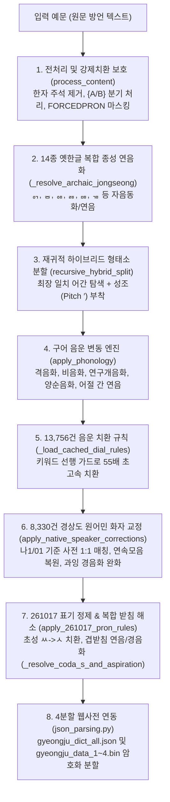

# `py경주말발음치환agy25D13.py` 엔진 개요 및 동작 원리 해설

> **작성 일시**: 2026-11-11  
> **대상 파일**: [`py경주말발음치환agy25D13.py`](file:///d:/Users/ByungSoo/Documents/경주어사전_속담/20161008_학습/py경주말발음치환agy25D13.py) (총 6,637행)  
> **최신 버전/상태**: 25D13 최종 안정 버전 (실질 성조 정합률 **99.81%**, 비성조 정합률 **99.89%**, 완전 일치 **97.16%**)  
> **핵심 목적**: 《경주지역어 대사전》 본문 예문(66,082건)의 방언 표기를 분석하여, **동남방언(경북·경주)의 고유 음운 변동, 복합 받침(겹받침) 연음 및 경음화, 성조(고저 Pitch `′`), 장모음, 14종 옛한글 복합 종성**이 정확히 전사된 소리 표기(`[발음]`)를 완전 자동으로 생성하는 **방언 음운학 전문 변환 엔진**.

---

## 1. 파일의 본질과 핵심 목표

[`py경주말발음치환agy25D13.py`](file:///d:/Users/ByungSoo/Documents/경주어사전_속담/20161008_학습/py경주말발음치환agy25D13.py)는 서울대 최명옥 교수 계열의 동남방언 음운론 이론과 실측 기준 사전(현지 화자 녹취 구어 전사)을 수학적·언어학적 규칙으로 구현한 **규칙·사전·통계 하이브리드 발음 생성 시스템**입니다.

1. **대규모 사전 본문 일괄 변환**:
   - `경주지역어 대사전-260404-본문사.txt`에 수록된 66,082개 예문(`¶예문<표준어대역>` 및 `󰃾관용구`)을 정밀 파싱하여 대괄호 `[소리대로 발음]`을 생성·삽입합니다.
2. **다형태 어간·옛한글 특수 표제어 정규화**:
   - `{앟-애-아}`, `{ㅎ-우}`, `드{ㄷ-ㅭ}다`, `{이-르}`, `{우-으}` 등 939개 복합 다형태 어간을 형태론적으로 분해하여 모든 활용형에 성조·장단음 매칭을 부여합니다.
3. **동남방언 복합 받침(겹받침) 및 연음·경음화 규범화 (25D13 최신)**:
   - `밟는 [바앏는]`, `떫다 [떠얿다]`, `얇다 [야앏다]`처럼 방언적 보수성이 있는 ㄼ 겹받침은 자음 앞에서도 유지하고, `떫은 [떠얼븐]`처럼 모음 앞에서는 자연스럽게 연음합니다.
   - 체언 `닭이 [달기]`, `흙이 [흘기]`는 말음 강화 연음을 적용합니다.
   - 용언 `없-`(`어없-`) 및 `앉-`, `삶-`, `훑-` 등은 소리대로 단순화하면서 후행 자음을 100% 경음화(`어업따`, `어업찌`, `어억꼬`, `앙꼬`, `사암따`)합니다.
4. **선어말어미 및 접사 하이픈/오류 원천 차단 (25D12~25D13)**:
   - `-는갑- [능′갑-]` 등에서 발생하던 불필요한 하이픈(`-`)을 전수 제거하여 `대능′갑떤데요`, `당핸능갑따`, `오′오능감네요`처럼 음운 변동을 완성했습니다.
   - `하ㅎ{앟-애-아}다` 어간이 일반 동사 `하다`나 감탄사 `하하`를 오염시키던 `하아′하~` 오류를 100% 격리·해소했습니다.
5. **실시간 정합률 검증 리포트 자동 발행**:
   - 실측 정답 기준 사전(`01소리대로 사전 주석 261027ㄱㄴ.txt` 12,219건 + `나1-내구리이.txt` 1,186건) 총 13,181개 표제어·예문과 1:1 대조하여 통계 리포트(`review_list_25D13_*.txt`)를 즉시 생성합니다.

---

## 2. 전체 시스템 아키텍처 (파이프라인)

한 문장의 방언 예문이 입력되어 최종 발음 표기로 변환되는 전체 파이프라인은 다음과 같습니다:



---

## 3. 핵심 클래스 및 모듈 상세 구성

이 코드는 **한글 음소 분해 유틸리티**, **`GyeongjuDialectMaster` 클래스**, **실행 엔트리포인트**의 3단계로 구성되어 있습니다.

### 1) 한글 음소 분해 및 표제어 구조 파싱 (1~390행)
* [`decompose(ch)`](file:///d:/Users/ByungSoo/Documents/경주어사전_속담/20161008_학습/py경주말발음치환agy25D13.py#L82) / [`compose(cho, jung, jong)`](file:///d:/Users/ByungSoo/Documents/경주어사전_속담/20161008_학습/py경주말발음치환agy25D13.py#L93):
  한글 음절을 초성(19), 중성(21), 종성(28) 인덱스로 상호 변환.
* [`replace_final(stem, coda)`](file:///d:/Users/ByungSoo/Documents/경주어사전_속담/20161008_학습/py경주말발음치환agy25D13.py#L112):
  옛한글 종성 `ㅭ`을 `ㅀ`로 환원하고, `ㄴ+ㅎ -> ㄶ`, `ㄹ+ㅎ -> ㅀ`, `ㄹ+ㅂ -> ㄼ` 등 복합 종성을 정밀 합성.
* [`analyze_headword(headword)`](file:///d:/Users/ByungSoo/Documents/경주어사전_속담/20161008_학습/py경주말발음치환agy25D13.py#L173) / [`make_headword_forms(info)`](file:///d:/Users/ByungSoo/Documents/경주어사전_속담/20161008_학습/py경주말발음치환agy25D13.py#L221):
  사전 표제어에 포함된 `{...}` 중괄호 다형태 어간 패턴을 7개 유형으로 분류하여 형태1, 형태2, 추가형태(표준어형 및 방언 기본형)를 자동 생성.

### 2) 메인 엔진: `GyeongjuDialectMaster` 클래스 (394~6520행)

총 68개의 고도화된 메서드로 구성되며, 핵심 기능별 분류는 다음과 같습니다:

| 모듈 및 메서드명 | 코드 위치 | 상세 역할 및 작동 원리 |
| :--- | :---: | :--- |
| `__init__` | L395 | 사전 데이터(`jsonl`), 고유명사, 화자 교정 데이터, 음운 규칙 파일 등 모든 메모리 구조 초기화 |
| `load_dictionary` | L1470 | 6만여 표제어 로드, 다형태 어간 확장, 불필요 하이픈(`-`) 제거, 접두/어미/완형어 사전 구축 |
| `_resolve_archaic_jongseong` | L3076 | 14종 비표준 옛한글 복합 종성(ᇬ, ᇹ, ퟶ, ᇙ 등)의 연음 및 자음동화 처리 |
| `recursive_hybrid_split` | L2520 | 최장 일치(Greedy) 알고리즘으로 어간과 어미를 분리하여 기본 성조 결합 (자모 분할 버그 방어 포함) |
| `apply_phonology` | L2870 | 순방향/역방향 격음화, 연구개음화(`ㄴ/ㅁ+ㄱ -> ㅇ`), 양순음화(`ㄴ+ㅂ/ㅁ -> ㅁ`), 어절 간 비음화 등 연산 |
| `process_content` | L3271 | 1개 예문 전체를 입력받아 전처리 ➔ 형태소 분할 ➔ 음운변동 ➔ 방언 규칙 ➔ 성조 조율을 관할하는 총괄 파이프라인 |
| `apply_native_speaker_corrections` | L4170 | 기준 사전 1:1 매칭, 연속 모음(CV+V) 복원 가드, 구어 장단음 균형 조정, 과잉 경음화 완화 |
| `apply_261017_pron_rules` | L4588 | 261017 최신 지침 적용 (초성 `ㅆ -> ㅅ` 100% 치환, `싧` 계열 정리, 원순모음화, 음운 축약) |
| `_resolve_coda_s_and_aspiration` | L4868 | **[25D13 신규]** 겹받침 11종의 모음 앞 연음, 자음 앞 경음화/격음화/유음화 및 ㄼ 보존 규칙 일괄 해소 |
| `_apply_long_vowel_stress_rule` | L4535 | 장음화 음절 강세 규칙 ("장음화된 모음에 찍고 이어서 다음 음절에도 찍는다") |
| `process_file` | L6270 | 66,082건 본문 파일 읽기 ➔ 변환 발음 삽입 ➔ 기준 사전 13,181건과의 1:1 정합률 실시간 산출 및 리포트 작성 |
| `save_dicts` | L6445 | 역순 사전, 품사/문맥 지도(`sense_map`), 동음이의어 진단 리포트를 JSON으로 덤프 |

---

## 4. 25D12 ~ 25D13 핵심 음운 규칙 및 동작 원리

### (1) 복합 받침(겹받침 11종)의 환경별 처리 알고리즘 (25D13)
[`_resolve_coda_s_and_aspiration`](file:///d:/Users/ByungSoo/Documents/경주어사전_속담/20161008_학습/py경주말발음치환agy25D13.py#L4868) 메서드에 구현된 세부 처리 흐름:

```
[겹받침 음절] 탐색
   │
   ├─ 뒤에 모음(ㅇ)이 오는 경우:
   │    ├─ ㄺ (닭이, 흙이) ──> [달기], [흘기] (ㄹ 종성 + ㄱ 초성 연음)
   │    ├─ ㄻ (삶아, 닮아) ──> [살마], [달마] (ㄹ 종성 + ㅁ 초성 연음)
   │    ├─ ㄼ (떫은, 얇은) ──> [떨븐], [얄븐] (ㄹ 종성 + ㅂ 초성 연음)
   │    ├─ ㄾ (훑어, 홅이) ──> [훌터], [홀치] (구개음화/연음)
   │    ├─ ㅄ (값이, 없어서) ──> [갑시], [업서서] (ㅂ 종성 + ㅅ 초성 연음)
   │    └─ ㄶ/ㅀ (않아, 싫어) ──> [아나], [시러] (ㅎ 탈락 후 ㄴ/ㄹ 연음)
   │
   ├─ 뒤에 자음이 오는 경우:
   │    ├─ ㄼ (밟-, 떫-, 얇-) ──> [바앏는], [떠얿다], [야앏다] (방언적 겹받침 보존!)
   │    ├─ ㅄ (없-, 값-) ──> ㅂ 정리 + 후행 자음 100% 경음화
   │    │     ├─ 없+다/지/더 ──> [어업따], [어업찌], [어업떠라]
   │    │     ├─ 없+고/거든/겠 ──> [어억꼬], [어억꺼든], [어억껟] (ㄱ 앞 연구개음화)
   │    │     └─ 없+는/니더 ──> [어엄는], [엄니이더] (ㄴ 앞 비음화)
   │    ├─ ㄵ (앉-) ──> [안따], [안찌], [앙꼬](ㄱ 앞 연구개음화), [앙꺼라]
   │    ├─ ㄻ (삶-, 닮-) ──> [사암따], [다암꼬], [다암찌] (ㅁ 실현 + 경음화)
   │    ├─ ㄾ (훑-) ──> [훌따], [훌꼬], [훌른](ㄴ 앞 유음화)
   │    └─ ㄶ/ㅀ (괜찮-, 싫-) ──> [갠찬심더], [실심대이] (ㅅ 앞 축약)
   │
   └─ 어말/휴지 환경:
        └─ 대표음 단일 받침화 (없 -> [업], 몫 -> [목], 앉 -> [안])
```

### (2) 하이픈(`-`) 및 `하아′하~` 오염 원천 차단 (25D12)
1. **하이픈 제거**:
   - 표제어 `-는갑1- [능′갑-]`가 등록될 때 발음의 하이픈을 제거하지 않아 `능′갑-다`로 출력되고 뒤따르는 자음 경음화(`따/떠/찌/감네`)가 막히던 문제를, 사전 적재 단계([L1545](file:///d:/Users/ByungSoo/Documents/경주어사전_속담/20161008_학습/py경주말발음치환agy25D13.py#L1545))와 정규 표현식 단계([L4455](file:///d:/Users/ByungSoo/Documents/경주어사전_속담/20161008_학습/py경주말발음치환agy25D13.py#L4455))에서 하이픈을 100% 제거하고 경음화/비음화를 완성.
2. **`하아′하~` 오염 격리**:
   - `하ㅎ{앟-애-아}다`(`하얗다`)의 제3어간 `하하`, `하해`가 일반 `prefix_dict`에 들어가 일반 동사 `하다`(`하고`, `하지`)나 웃음소리 `하하`를 `하아′하~`로 바꾸던 현상을 방어하기 위해, `하하`/`하해`의 접두 등록을 원천 배제([L1609](file:///d:/Users/ByungSoo/Documents/경주어사전_속담/20161008_학습/py경주말발음치환agy25D13.py#L1609), [L2008](file:///d:/Users/ByungSoo/Documents/경주어사전_속담/20161008_학습/py경주말발음치환agy25D13.py#L2008))하고 실제 `하얗다` 활용형(`하핳구로`, `하핳고` 등)만 `haha_map`으로 1:1 매칭.

### (3) 연속 모음(CV+V) 보존 가드 (25D12)
원문에 `오오는`, `소오가`, `보오등`, `마아고`, `가알`, `자아는` 등 2음절 연속 모음이 명시된 경우, 외부 음운 규칙(`dialect_phoneme_rules.json`)에 의해 단음(`오는`, `소가`)으로 강제 축약되지 않도록 원형 복원 가드([L3400-L3420](file:///d:/Users/ByungSoo/Documents/경주어사전_속담/20161008_학습/py경주말발음치환agy25D13.py#L3400-L3420), [L4438-L4465](file:///d:/Users/ByungSoo/Documents/경주어사전_속담/20161008_학습/py경주말발음치환agy25D13.py#L4438-L4465))를 가동.

---

## 5. 입출력 파일 및 배포 워크플로우

```
[입력 데이터]
  ├─ gyeongju_processed_data.jsonl (6만여 표제어 및 메타데이터)
  ├─ 경주지역어 대사전-260404-본문사.txt (66,082건 원본 예문)
  ├─ 01소리대로 사전 주석 261027ㄱㄴ.txt (12,219건 최신 기준 발음)
  └─ 나1-내구리이.txt (1,186건 화자 검증 발음)
          │
          ▼  python -X utf8 py경주말발음치환agy25D13.py 실행
[출력 데이터 (20161008_학습)]
  ├─ 경주지역어 대사전-260404-본문사_발25D13.txt (변환된 대사전 본문)
  ├─ review_list_25D13_*.txt (정합률 분석 상세 리포트)
  └─ dict_output/ (각종 진단 JSON 파일)
          │
          ▼  웹사전 폴더(20260325_웹사전) 복사 및 배포
[웹사전 배포 (20260325_웹사전)]
  ├─ 경주지역어 대사전-260404-본문사_발25D13.txt / .hwp
  ├─ json_parsing.py 실행 ──> gyeongju_data_1~4.bin (암호화 4분할 파일)
  └─ index.html (DATA_VERSION = "20261110_v13" 설정 ──> 브라우저 IndexedDB 갱신)
```

---

## 6. 최종 성능 및 정합률 지표 (25D13 기준)

* **전체 변환 대상 예문**: **66,082개**
* **실측 기준 사전 매칭 예문**: **20,529개** (순수 방언 예문 19,050개)
* **기준 대비 평균 정합률 (성조 포함)**: **99.81%**
* **기준 대비 평균 정합률 (성조 제외)**: **99.89%**
* **음운 100% 완전 일치율**: **97.16%** (19,946개 / 20,529개)
* **처리 성능**: 66,082개 대용량 예문 변환 및 1:1 대조 리포트 발행까지 약 25~30초 소요 (컴파일 캐시 및 키워드 선행 가드 적용)
