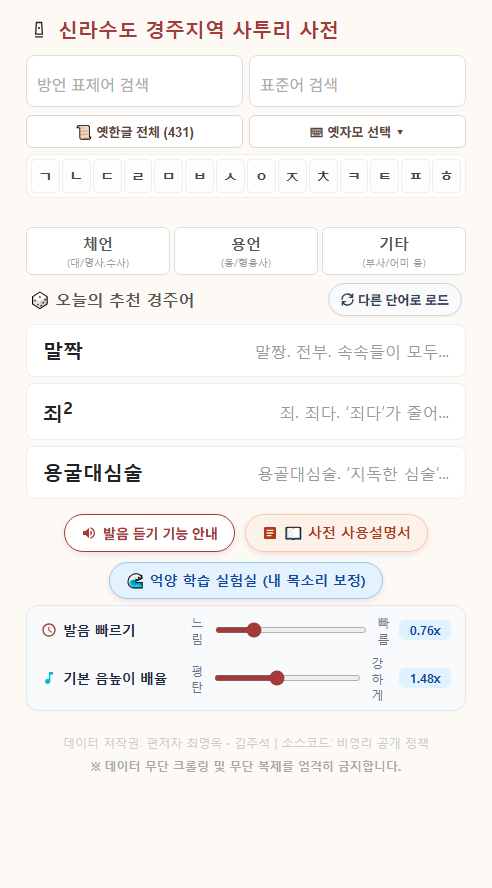
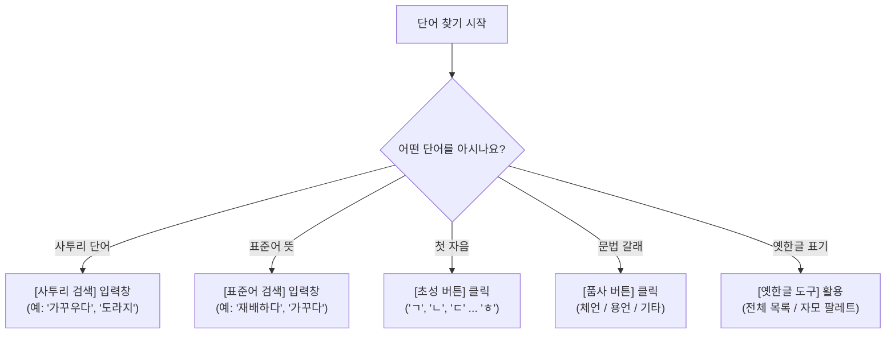
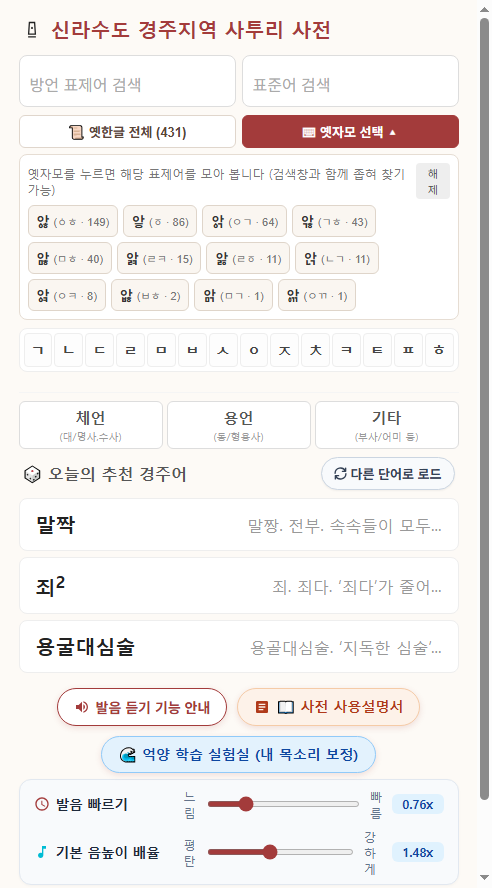
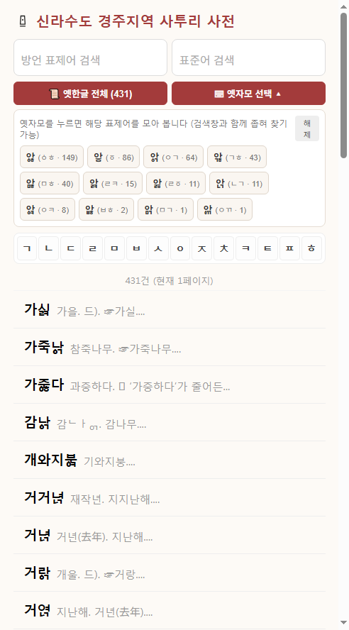
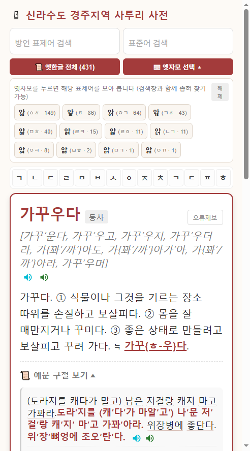
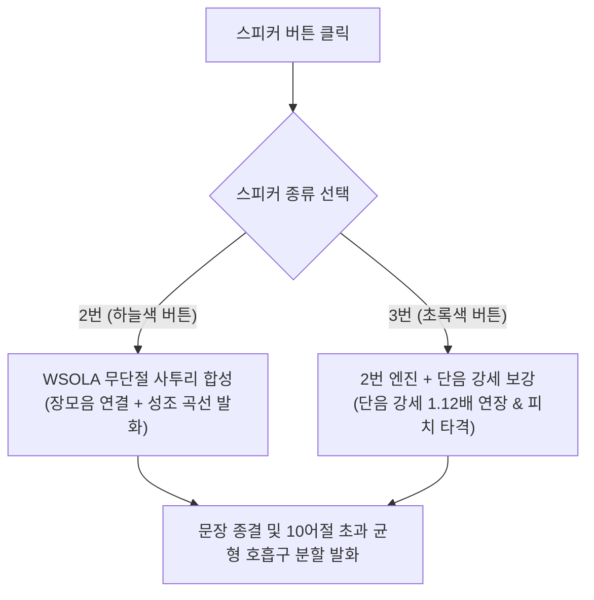
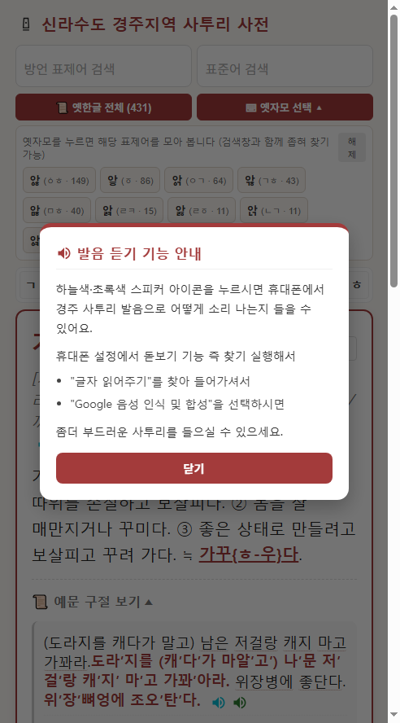
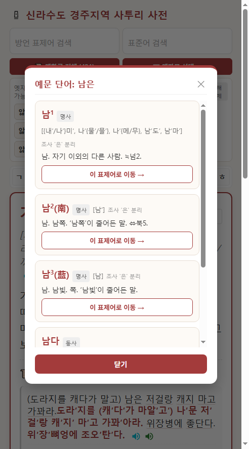
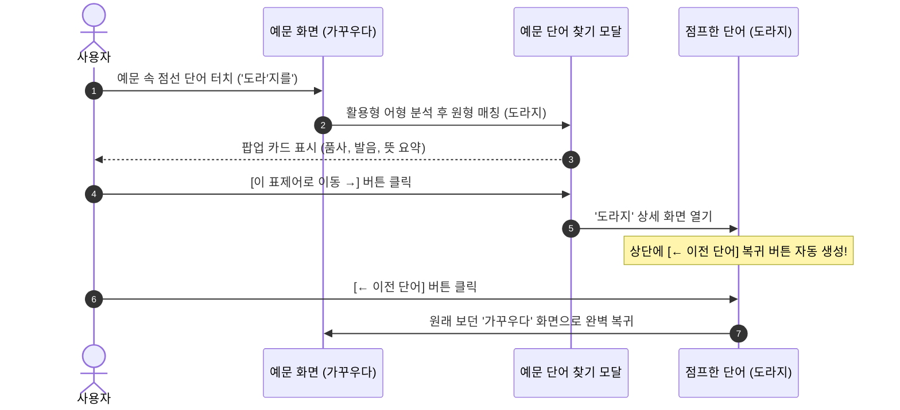

# 《신라수도 경주지역 사투리 사전》 상세 사용 설명서

> **자료 출처 및 저작권**  
> 편저자: 최명옥(서울대학교 명예교수) · 김주석  
> 수록 어휘: 경주 지역 토박이 방언 표제어 41,005건 및 풍부한 구술 실생활 예문·관용구·속담  
> 시스템: 웹 기반 실시간 반응형 방언 사전 & 무단절 성조 음성 합성(TTS) 엔진

---

## 1. 사전 소개 및 주요 특징

《신라수도 경주지역 사투리 사전》은 신라의 천년 수도였던 경주 지역의 고유 언어 유산을 집대성한 디지털 웹 사전입니다. 15세기 훈민정음 창제 당시의 성조(평성·거성·상성) 체계와 옛한글 자모(순경음, 아래아, 복합 자음 등)를 고스란히 간직한 살아있는 경주 방언을 누구나 쉽게 검색하고 원음의 억양 그대로 귀로 들을 수 있도록 개발되었습니다.

### 🌟 핵심 특장점
1. **41,005건의 방대한 어휘 수록**: 경주 지역 어르신들의 구술 채록과 문헌 자료를 망라한 정밀 사전
2. **옛한글 완벽 보존 & 3대 검색 지원**: 표준 유니코드(UTF-8 NFD) 자모 체계로 옛한글 표제어를 구현하고, 원클릭 필터·옛자모 팔레트·현대어 유사 검색을 모두 지원
3. **무단절 성조 사투리 음성 합성(TTS)**: 로컬 WSOLA 및 웹 브라우저 음성 엔진을 통해 경주 방언 특유의 고저 성조(High/Low Pitch)와 장단모음을 자연스럽게 구현
4. **상호 연결형 예문 학습**: 예문이나 속담 속에 등장하는 모든 경주 사투리 단어를 클릭하면 원형 표제어와 뜻풀이가 팝업으로 즉시 뜨며 단어 간 점프 탐색 가능
5. **하단 상시 조절 바**: 발음 속도와 기본 음높이(피치) 조절 바가 화면 하단에 고정 노출되어 언제든 내 귀에 맞는 사투리 음조로 조절 가능

---

## 2. 화면 구성 및 레이아웃 한눈에 보기

사전은 모바일 스마트폰과 태블릿, PC 모니터 모든 환경에 최적화된 반응형 인터페이스를 갖추고 있습니다.

### 📌 주요 화면 구역
| 구역 | 명칭 | 기능 설명 |
| :--- | :--- | :--- |
| **상단 헤더** | 제목 및 로고 | 《신라수도 경주지역 사투리 사전》 성덕대왕신종 모티프 로고 |
| **검색창 행** | 2중 입력창 | `방언 표제어 검색`창과 `표준어 검색`창이 나란히 배치되어 양방향 검색 가능 |
| **옛한글 도구** | `📜 옛한글 전체` / `⌨ 옛자모 선택 ▾` | 옛한글 표제어 전체 모아보기 및 12종 옛받침 자모 입력 팔레트 열기 |
| **초성 색인** | 초성 그리드 (`ㄱ` ~ `ㅎ`) | 19개 현대 한글 자음 버튼으로 해당 초성의 표제어 사전순 정렬 목록 열람 |
| **품사 필터** | `체언` / `용언` / `기타` | 명사/대명사/수사, 동사/형용사, 부사/어미 등 문법 갈래별 필터링 |
| **추천 경주어** | `🎲 오늘의 추천 경주어` | 사전 속 흥미로운 방언 단어 3개를 무작위 추천 (`다른 단어로 로드` 버튼 제공) |
| **하단 안내** | 기능 안내 & 실험실 링크 | `발음 듣기 기능 안내` 모달 팝업 및 `억양 학습 실험실(demo_prosody.html)` 바로가기 |
| **상시 조절바** | `발음 빠르기` & `기본 음높이 배율` | 저작권 바로 위 고정 영역으로, 메인과 상세 화면 모두에서 상시 조작 가능 |

---

## 3. 표제어 검색 방법 (5가지 탐색 경로)

사용자는 자신이 알고 있는 단어의 형태나 목적에 따라 5가지 방식으로 자유롭게 어휘를 찾을 수 있습니다.

### 3.1. 사투리 검색 (방언 표제어 입력)
- **입력창**: 좌측 `방언 표제어 검색` 입력창에 찾고자 하는 사투리를 입력합니다.
- **실시간 자동 검색**: 글자를 입력하는 즉시 0.2초 이내에 일치하는 표제어 목록이 하단에 나타납니다.
- **동의어/변이형 확장 검색**: `{}` 중괄호 표기(예: `가꾸{우/ㅎ}다`)로 묶인 어간 변이형도 자동으로 분해 매칭되므로 어느 형태를 검색해도 정확히 찾아냅니다.

### 3.2. 표준어 뜻풀이 검색 (역방향 검색)
- **입력창**: 우측 `표준어 검색` 입력창에 표준어 의미(예: `가꾸다`, `벼`, `호미`, `무덤`)를 입력합니다.
- **활용**: 경주 사투리를 정확히 모르더라도 "표준어로 '가꾸다'를 경주에서는 뭐라고 하지?" 궁금할 때 표준어를 입력하면 대응하는 경주 방언 표제어들을 한눈에 비교할 수 있습니다.

### 3.3. 초성 자음 탐색 (ㄱ ~ ㅎ)
- 검색창 아래 19개 자음 박스(`ㄱ`, `ㄲ`, `ㄴ`, `ㄷ`, `ㄸ`, `ㄹ`, `ㅁ`, `ㅂ`, `ㅃ`, `ㅅ`, `ㅆ`, `ㅇ`, `ㅈ`, `ㅉ`, `ㅊ`, `ㅋ`, `ㅌ`, `ㅍ`, `ㅎ`) 중 하나를 터치/클릭합니다.
- 해당 자음으로 시작하는 모든 단어가 정통 국어사전 순서(옛한글 조합 규칙 반영)로 나열됩니다.

### 3.4. 품사별 모아보기 필터
- `체언(대/명사,수사)`: 사물이나 사람, 수량을 나타내는 명사 중심 어휘 필터링
- `용언(동/형용사)`: 동작이나 상태를 나타내는 동사 및 형용사 필터링
- `기타(부사/어미 등)`: 경주 방언의 맛깔스러운 부사, 감탄사, 연결/종결 어미 필터링

### 3.5. 오늘의 추천 경주어 & 무작위 새로고침
- 메인 화면 하단의 `🎲 오늘의 추천 경주어` 카드 3장을 통해 매번 새로운 경주 고유어를 자연스럽게 접할 수 있습니다.
- 우측의 `다른 단어로 로드` 버튼을 누르면 즉시 새로운 랜덤 단어 3개가 교체 로드됩니다.

---

## 4. 옛한글 표제어 완벽 검색 가이드

경주 방언에는 조선 전기 문헌에 남아있던 순경음, 아래아, 옛이응, 복합 받침 등이 실제 발음으로 살아있어 사전 표제어에도 옛한글이 그대로 표기되어 있습니다. 본 사전은 별도의 옛한글 키보드가 없는 스마트폰 사용자도 손쉽게 옛한글을 찾을 수 있는 3중 검색 시스템을 제공합니다.

### 4.1. `📜 옛한글 전체` 원클릭 버튼
- 버튼을 한 번 누르면 사전에 수록된 모든 옛한글 표제어가 사전 자모 순서대로 즉시 필터링됩니다.

### 4.2. `⌨ 옛자모 선택 ▾` 팔레트 입력
- 버튼을 누르면 사전에 실제 빈출되는 **12종 핵심 옛받침 자모 칩**이 펼쳐집니다.

| 자모 칩 | 조합 형태 | 대표 발음 예시 단어 |
| :---: | :---: | :--- |
| **ᇅ** | `ㄴㄱ` 받침 | `금녀ᇅ` (금녘, 서쪽) |
| **ᇹ** | `ㆆ` (여린히읗) 받침 | `들어부ᇹ다` (단숨에 들이붓다) |
| **ᇾ** | `ㄱㅎ` 받침 | `가ᇾ` (겉, 표면) |
| **ᇬ** | `ㅇㄱ` 받침 | `가죽나ᇬ` (가죽나무) |
| **ᇡ** | `ㅁㅎ` 받침 | `구ᇡ` (구멍), `왕이ᇡ다` (왕임ㅎ다) |
| **ᇘ** | `ㄹㅋ` 받침 | `부ᇘ다` (붉다) |
| **ᇙ** | `ㄹㆆ` 받침 | `이ᇙ` (일찍) |
| **ᇯ** | `ㅇㅋ` 받침 | `주ᇯ다` (죽다) |
| **ᇥ** | `ㅂㅎ` 받침 | `잡수ᇹ고` (잡수시고) |
| **ᇚ** | `ㅁㄱ` 받침 | `나ᇚ` (나무) |
| **ᇭ** | `ㅇㄲ` 받침 | `바ᇭ` (밖) |
| **ퟶ** | `ㆁㅎ` 받침 | `가ퟶ` (가장자리) |

> [!NOTE]
> **옛자모 팔레트 12종 정돈 및 '왕임ㅎ다' 오기 교정**  
> 기존 원문의 '왕ᄋᆝᇡ다'(왕임하다의 축약형)에 포함되어 있던 '아래아+이'(`ᆝ`) 표기는 조사 결과 사전 전체에서 유일하게 나타난 '이' 모음(`ᅵ`)의 오기임이 확인되어 `왕이ᇡ다`로 바로잡았습니다. 이에 따라 사전에 실제로 쓰이는 고유 옛한글 자모는 12종의 옛받침 자모(종성)로 정돈되었으며, 팔레트에서도 불필요해진 'ㆍㅣ' 칩이 제외되었습니다.

> [!TIP]
> 자모 칩을 터치하면 해당 옛자모가 자동으로 검색창에 입력되고, 해당 자모가 포함된 모든 단어 목록으로 즉시 필터링됩니다. 다시 버튼을 누르면 팔레트가 접힙니다.

### 4.3. 현대 한글 자모 근사 검색 (유사자모 매칭)
키보드에 옛한글이 없더라도 **일반 현대 한글**로 검색하면 내부 변환 엔진(`buildApproxSearchForms`)이 자동으로 유사 옛한글을 함께 찾아줍니다.
- 예: `금녁` 또는 `금녕` 검색 시 → `금녀ᇅ` 자동 매칭
- 예: `들어붓다` 검색 시 → `들어부ᇹ다` 자동 매칭

### 4.4. 옛한글 사전식 정렬 원칙
- 본 사전은 국립국어원 옛한글 정렬 표준과 훈민정음 자모 체계에 맞춰 정렬됩니다.
- 예: `ᇅ(ㄴㄱ)` 받침은 현대 `ㄴ`과 `ㄵ` 사이에 정확히 위치하며, `ᇹ(ㆆ)` 받침은 `ㅎ` 직전에 순서대로 배열되어 사전을 넘기듯 직관적으로 찾을 수 있습니다.

---

## 5. 검색 결과 목록 탐색

검색창에 글자를 입력하거나 초성/옛한글 버튼을 누르면 목록 뷰가 열립니다.

1. **검색 건수 안내**: 목록 상단에 `○건 (현재 1페이지)`로 총 검색된 어휘 수가 표시됩니다.
2. **페이지네이션**: 한 페이지당 50건씩 쾌적하게 로딩되며, 하단 번호 및 `이전`/`다음` 버튼으로 페이지를 넘길 수 있습니다.
3. **표제어 카드 요약 정보**:
   - 표제어 명칭 및 동음이의어 번호(상첨자 `¹`, `²`)
   - 품사 구분 태그 (`󰃃 명사`, `󰂿 동사`, `󰃰 형용사` 등)
   - 간결한 대표 뜻풀이 미리보기
4. **상세 진입**: 카드를 터치하면 해당 단어의 상세 정보 화면으로 전환됩니다.

---

## 6. 단어 상세 화면 기능 상세

상세 화면에서는 표제어의 완벽한 문법 정보, 정밀 발음 표기, 단계별 뜻풀이, 실생활 예문과 관용구/속담을 집약해 보여줍니다.

### 6.1. 상단 표제어 및 품사 배지
- **표제어명**: 대형 폰트로 선명하게 노출되며, 옛한글 첫가끝 자모와 상첨자 숫자가 깔끔하게 렌더링됩니다.
- **품사 배지**: 붉은색 포인트 배지로 품사 갈래를 직관적으로 명시합니다.
- **오류 제보 버튼**: 우측 상단 `오류제보` 링크를 누르면 사전 편찬팀으로 수정 제안 이메일을 바로 발송할 수 있습니다.

### 6.2. 발음 표시 및 2·3번 스피커 버튼
- **발음 기호 구역**: 음장(장모음 `ː` 또는 모음 연속)과 고조 성조(강세표 `′`)가 표시된 정밀 음성학적 발음 표기가 나타납니다.
- **2번 스피커 (하늘색)**: 무단절 WSOLA 사투리 연속 합성 음성 재생
- **3번 스피커 (초록색)**: 단음 강세 1.12배 연장 및 피치 타격 강화 음성 재생

### 6.3. 상세 뜻풀이 구역
- 여러 의미를 지닌 다의어의 경우 `1.`, `2.`, `3.` 번호별로 상세 표준어 뜻풀이가 줄바꿈되어 정돈되어 제공됩니다.

### 6.4. `📜 예문 구절 보기` 아코디언 토글
- 기본 상태에서는 화면을 깔끔하게 유지하기 위해 접혀 있으며, 버튼을 클릭하면 활성화되어 예문과 속담이 펼쳐집니다.
- **방언 구술 예문**: 실제 경주 지역 방언 화자들의 자연스러운 구술 녹취 문장이 제공됩니다.
- **표준어 대역**: 각 예문 하단에 회색 박스로 표준어 번역이 함께 제공되어 의미를 쉽게 대조할 수 있습니다.
- **스피커 버튼 단일 배치**: 문장 중간에 쉼표나 마침표가 있어도 중간을 끊지 않고 **예문 맨 끝에 1회만 스피커 버튼 쌍(2번·3번)이 배치**되어 문장 전체를 통으로 유려하게 들을 수 있습니다.

---

## 7. 사투리 발음 듣기(TTS) 및 음성 엔진 가이드

본 사전의 백미는 단순한 텍스트 사전을 넘어 **경주 방언의 억양과 성조를 소리로 직접 체득**할 수 있다는 점입니다.

### 7.1. 2번 스피커 (하늘색, `.speaker-btn-sky`)
- **엔진 특징**: WSOLA(Waveform Similarity Overlap-Add) 무단절 연속 발화 알고리즘
- **피치 통일**: 이전 버전에서 평음이 지나치게 낮게 가라앉던 현상을 완전히 개선하여, **평음과 고음 구분 없이 안정적인 기존 고음 기준 피치를 기본 피치로 통일**했습니다.
- **우클릭 부가 기능**: PC에서 하늘색 버튼을 마우스 우클릭하면 브라우저 내 설치된 한국어 남성 음성 목록을 수동 선택할 수 있는 팝업이 뜹니다.

### 7.2. 3번 스피커 (초록색, `.speaker-btn-green`)
- **엔진 특징**: 2번 엔진의 자연스러운 음조 위에, **어절 내 단음 강세(Accent) 음절을 약 1.12배 연장하고 피치 타격을 집중**시키는 음성학적 보강 엔진
- **청취 효과**: 경상도 방언 특유의 "툭 치고 올라가는 억센 액센트"를 귀로 훨씬 명확하게 포착할 수 있어 방언 학습에 이상적입니다.
- **우클릭 부가 기능**: PC에서 초록색 버튼을 마우스 우클릭하면 단음 강세 연장 배율(기본 1.12배, 1.05배 ~ 1.35배)을 원하는 수치로 즉시 변경할 수 있습니다.

### 7.3. 긴 문장(10어절 초과) 균형 호흡구 분할 로직
- **10어절 이하 문장**: 쉼표(`,`)가 있더라도 문장을 쪼개지 않고 **1개의 자연스러운 호흡구로 매끄럽게 발화**합니다.
- **10어절 초과 장문**: 기계적으로 10번째에서 잘라 꼬리를 남기지 않고, **문장 중앙 균형 지점 근처의 쉼표(`,`)나 경주 방언 연결어미(`-머`, `-가아`, `-고`, `-니꺼네`, `-는데`, `-거덩` 등)**를 스스로 찾아 6~8어절 단위로 숨을 고르며 균형 있게 나누어 읽어줍니다.

### 7.4. 모바일 최적 음성 설정 팁
스마트폰 기종에 따라 사투리가 어색한 기계음으로 들릴 경우, 스마트폰 설정에서 TTS 엔진을 Google 음성으로 변경하면 가장 유려한 억양을 들을 수 있습니다.

1. 휴대폰 [설정] 앱 실행
2. 상단 돋보기(검색)에서 **"글자 읽어주기"** 또는 **"TTS"** 검색
3. [기본 엔진]을 **"Google 음성 인식 및 합성"**으로 선택

---

## 8. 하단 상시 조절 바 활용법

화면 하단 저작권 표시 바로 위에는 슬라이더 조절 바 2종이 배치되어 있습니다. 이 조절 바는 **메인 첫 화면뿐 아니라 개별 단어 상세 화면에서도 상시 노출**됩니다.

### 8.1. `발음 빠르기` 조절 바
- **범위**: `0.60x` (느림) ~ `1.30x` (빠름)
- **기본값**: `0.76x` (경상도 특유의 음장과 성조를 또렷하게 음미하기에 가장 적합한 표준 속도)
- 슬라이더를 좌우로 드래그하면 배율 배지가 실시간으로 갱신되며 즉시 모든 발화 속도에 적용됩니다.

### 8.2. `기본 음높이 배율` 조절 바
- **범위**: `1.05x` (평탄) ~ `2.10x` (강하게)
- **기본값**: `1.48x` (+6.8 반음 상승 대역)
- **특징**: 평음과 고음 구분 없이 사전 전체 음성의 기본 피치 레벨을 일괄 조절합니다. 내 폰의 음성이 너무 가라앉거나 반대로 너무 가늘게 느껴질 때 내 귀에 편안한 높이로 자유롭게 미세 튜닝할 수 있습니다.
- **자동 저장**: 설정한 속도와 피치 수치는 브라우저 저장소(`localStorage`)에 자동 기억되므로 사전을 다시 열어도 유지됩니다.

---

## 9. 예문 단어 인터랙티브 팝업 & 표제어 내비게이션

예문을 읽다가 모르는 사투리 어휘가 나왔을 때, 검색창으로 다시 돌아가 타이핑할 필요 없이 단어를 터치하는 것만으로 즉시 뜻을 확인하고 이동할 수 있습니다.

### 9.1. 예문 속 단어 터치 (`.ex-word-link`)
- 펼쳐진 예문 구절을 보면 단어 아래에 **연한 점선**이 그어져 있습니다.
- 궁금한 단어를 마우스로 클릭하거나 스마트폰 화면에서 터치합니다.

### 9.2. `예문 단어 찾기` 미리보기 모달 팝업
- 터치 즉시 화면 중앙에 팝업창이 뜨며, 사투리 활용형(예: `가꽈′아라`, `도라′지를`, `대추가`, `심술이`)에서 조사와 어미를 분리 분석하여 매칭되는 **원형 표제어 카드**를 보여줍니다.
- 카드에는 표제어, 품사, 발음, 핵심 뜻풀이가 깔끔하게 요약되어 있어 예문의 문맥을 바로 이해할 수 있습니다.

### 9.3. `[이 표제어로 이동 →]` 원클릭 점프
- 팝업 카드의 하단 `[이 표제어로 이동 →]` 버튼을 누르면 팝업이 닫히며 해당 단어의 정식 상세 페이지로 즉시 이동합니다.

### 9.4. `← 이전 단어` 뒤로가기 스택 복귀
- 예문 단어 링크를 타고 다른 단어로 점프하면, 상단 버튼 영역에 **`← 이전 단어`** 버튼이 자동으로 나타납니다.
- 단어를 여러 번 타고 연속으로 이동하더라도 히스토리 스택이 유지되어, `← 이전 단어` 버튼을 누르면 이전에 읽던 단어로 한 단계씩 순서대로 완벽하게 되돌아올 수 있습니다.
- 언제든 `← 목록으로 돌아가기`를 누르면 원래의 전체 검색 목록으로 복귀합니다.

---

## 10. 단축키 및 제스처 / 보안 안내

### 10.1. 데스크톱 단축키 & 제스처
- **검색창 이동**: 메인 화면에서 아무 키나 입력하기 시작하면 방언 검색창에 포커스가 들어옵니다.
- **스피커 좌클릭**: 발음 재생 (2번: WSOLA / 3번: 단음강세 보강)
- **스피커 우클릭**: 고급 음성 설정 (남성 음성 선택 / 강세 연장 배율 조정)
- **모달 닫기**: 모달 바깥의 어두운 배경 영역을 클릭하거나 모달 우측 상단 `✕` 또는 하단 `닫기` 버튼 클릭

### 10.2. 무단 복제 방지 및 저작권 보호
- 본 사전은 편저자 선생님들의 평생에 걸친 구술 채록과 학술 연구 성과물입니다.
- **비영리 공개 원칙**: 웹 브라우저를 통한 개인 학습 및 학술 연구 목적의 열람은 상시 자유롭게 허용됩니다.
- **불법 스크래핑 차단**: 데이터 무단 크롤링, 상업적 대량 복제 및 소스 탈취를 방지하기 위해 마우스 우클릭 및 소스 검사 단축키가 기본 보호 처리되어 있습니다.

---

## 11. 자주 묻는 질문 (FAQ)

### Q1. 스마트폰에서 스피커 버튼을 눌렀는데 소리가 나지 않거나 반응이 없어요.
- 스마트폰의 미디어 볼륨이 무음으로 설정되어 있는지 확인해 주세요.
- 아이폰(iOS) 사파리 브라우저는 화면과의 첫 사용자 터치 인터랙션 이후에만 오디오 재생 권한이 부여되므로, 화면을 한 번 터치한 후 스피커 아이콘을 눌러주세요.

### Q2. 2번 스피커와 3번 스피커의 소리가 어떻게 다른가요?
- **2번(하늘색)**은 문장 전체가 물 흐르듯 끊김 없이 이어지는 자연스러운 대화체 사투리입니다.
- **3번(초록색)**은 어절 속에 강세표(`′`)가 붙은 짧은 음절의 길이를 1.12배 늘려 높은 피치로 힘주어 때려주므로, 경상도 방언 특유의 액센트가 귀에 쏙쏙 박히듯 전달됩니다.

### Q3. 안드로이드 기기에서 옛한글 받침이 네모(□)로 깨져 보일 수 있나요?
- 본 사전은 표준 유니코드 5.2 이상의 NFD 첫가끝 첫소리·가운뎃소리·끝소리 자모 결합 표준을 따르므로 최신 안드로이드 및 PC에서 완벽히 조합되어 보입니다. 만약 구형 폰에서 결합이 되지 않을 경우 최신 Chrome 브라우저를 이용하시면 완벽한 글꼴로 렌더링됩니다.

### Q4. 내가 원하는 음색으로 발음을 더 조절하고 싶어요.
- 메인 화면 하단의 `🌊 억양 학습 실험실 (demo_prosody.html)` 링크를 클릭하시면, 피치 상승폭과 장모음 연장 배율 등을 직접 실시간 슬라이더로 조작하며 내 목소리에 맞게 사투리 프로필을 커스터마이징할 수 있습니다.

---

*본 설명서는 《신라수도 경주지역 사투리 사전》의 2026 최신 웹 버전 인터페이스 및 음성 엔진 기준에 맞춰 제작되었습니다.*
